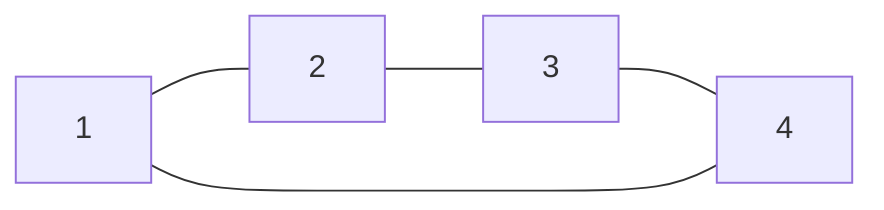

**Contexto:**  

Em uma terra distante chamada Graphlandia, cada cidade é um nó em um vasto reino de dados. Os caminhos entre as cidades são arestas que conectam estes nós. Um jovem herói, CodeMaster, tem a tarefa de mapear todas as conexões entre as cidades usando uma matriz de adjacência, para garantir que todas as rotas estão seguras e acessíveis para os viajantes.

**Entradas:** 

A primeira linha contém dois inteiros N e M, onde N é o número de cidades (nós) (1 ≤ N ≤ 100) e M é o número de caminhos (arestas) (1 ≤ M ≤ N*(N-1)/2). As próximas M linhas descrevem os caminhos, cada uma contendo dois inteiros A e B (1 ≤ A, B ≤ N), indicando um caminho bidirecional entre as cidades A e B.

**Saída:** 

Imprima uma matriz de adjacência de N×N que represente as conexões entre as cidades. Se houver um caminho entre A e B, marque como 1; caso contrário, 0.

| **Entrada** | **Saída** |
| ----------- | --------- |
| 4 4         | 0 1 0 1   |
| 1 2         | 1 0 1 0   |
| 2 3         | 0 1 0 1   |
| 3 4         | 1 0 1 0   |
| 4 1         |           |

## Código

```cpp
#include<iostream>
using namespace std;

int main(){

    //Variáveis

    int n, m;
    
    cin >> n >> m;

    //Construção da Matriz
    int matriz [100][100] = {0};
    //< -- '{0}' significa preencher a matriz toda com 0

    for(int i = 0; i < m; i++)  {
        int a, b;

        cin >> a >> b;

        matriz[a - 1][b - 1] = 1;
        matriz[b - 1][a - 1] = 1;
    }
    // Varre toda matriz, expondo todos valores de todas as posições.
    // o "if(j < n - 1)" é apenas para evitar um espaço no final da linha

    for(int i = 0; i < n; i++)  {
        for(int j = 0; j < m; j++)  {
        
            cout << matriz[i][j];
            if(j < n - 1) cout << " ";
        }
        cout << endl;
    }
    return 0;
}
```


