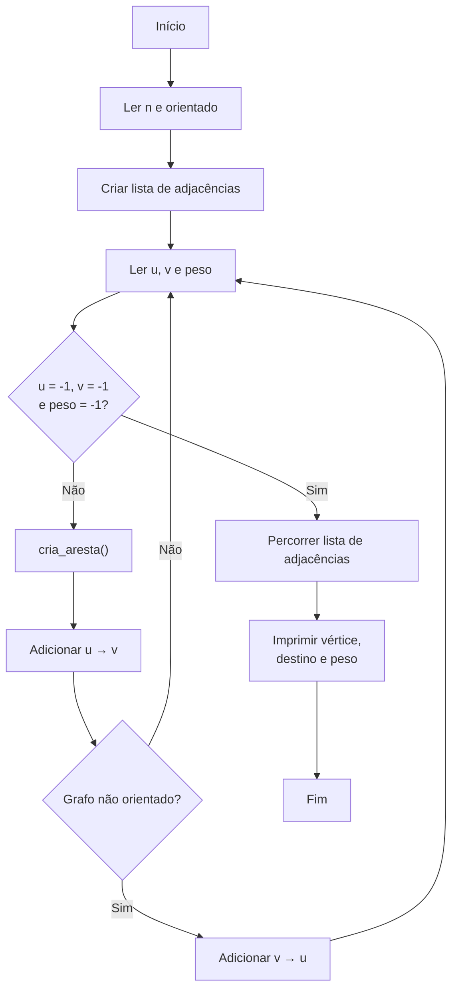

# Questão

##### Faça um programa que leia dos dados dos vértices e arestas de um grafo e os armazene em uma lista de adjacências. Depois mostre o grafo gerado.

Cada nó da lista de adjacências deve conter o vértice de destino e o peso da aresta.

Use a struct abaixo para implementar seu programa. 

```cpp
struct no  
{  
    int v; // vertice adjacente  
    int peso; // peso da aresta  
};
```

Faça uma função para criar as arestas. O cabeçalho desta função deve ser:

```cpp
void cria_aresta(list<no>adj[], int u, int v, int p, int orientado)
```

##### Entrada

A entrada consiste de várias linhas:

- a primeira linha contém dois inteiros: o primeiro corresponde ao número de vértices do grafo, e o segundo define se o grafo é orientado (1) ou não orientado (0).

- as demais linhas três inteiros, que correspondem ao vértice de origem, o vértice de destino e o peso de cada aresta, respectivamente. A entrada de dados termina quando ocorrer uma linha com três números iguais a -1 (esta não deve ser inserida no grafo).  

##### Saída

A saída deverá mostrar a lista de adjacências gerada, como no exemplo abaixo.

Exemplo 1

| Exemplo de entrada | Exemplo de saída |
| ------------------ | ---------------- |
| 5 1                | 0 2 4            |
| 4 1 3              | 0 1 2            |
| 0 2 4              | 1 3 2            |
| 1 3 2              | 2 4 7            |
| 3 1 3              | 3 1 3            |
| 0 1 2              | 3 4 2            |
| 2 4 7              | 4 1 3            |
| 3 4 2              | 4 0 1            |
| 4 0 1              |                  |
| -1 -1 -1           |                  |
|                    |                  |
| 5 0                | 0 2 4            |
| 4 1 3              | 0 1 2            |
| 0 2 4              | 0 4 1            |
| 1 3 2              | 1 4 3            |
| 3 1 3              | 1 3 2            |
| 0 1 2              | 1 3 3            |
| 2 4 7              | 1 0 2            |
| 3 4 2              | 2 0 4            |
| 4 0 1              | 2 4 7            |
| -1 -1 -1           | 3 1 2            |
|                    | 3 1 3            |
|                    | 3 4 2            |
|                    | 4 1 3            |
|                    | 4 2 7            |
|                    | 4 3 2            |
|                    | 4 0 1            |
|                    |                  |

## Código Completo

```cpp
#include <iostream>
#include <list>

using namespace std;

// Estrutura que representa uma aresta da lista de adjacência
struct no
{
    int v;      // vértice de destino
    int peso;   // peso da aresta
};

// Função responsável por criar uma aresta
void cria_aresta(list<no> adj[], int u, int v, int p, int orientado)
{
    // Adiciona a aresta u -> v
    adj[u].push_back({v, p});

    // Se o grafo NÃO for orientado,
    // também precisamos adicionar v -> u
    if (orientado == 0)
    {
        adj[v].push_back({u, p});
    }
}

int main()
{
    int n;
    int orientado;

    // Lê o número de vértices e se o grafo é orientado
    cin >> n >> orientado;

    // Cria um vetor de listas de adjacência
    list<no> adj[n];

    int u, v, p;

    // Lê as arestas até encontrar -1 -1 -1
    while (cin >> u >> v >> p)
    {
        // Verifica se chegou ao fim da entrada
        if (u == -1 && v == -1 && p == -1)
        {
            break;
        }

        // Cria a aresta no grafo
        cria_aresta(adj, u, v, p, orientado);
    }

    // Mostra a lista de adjacências
    for (int i = 0; i < n; i++)
    {
        for (const auto &x : adj[i])
        {
            cout << i << " " << x.v << " " << x.peso << endl;
        }
    }

    return 0;
}
```

## Lógica de Diagrama




