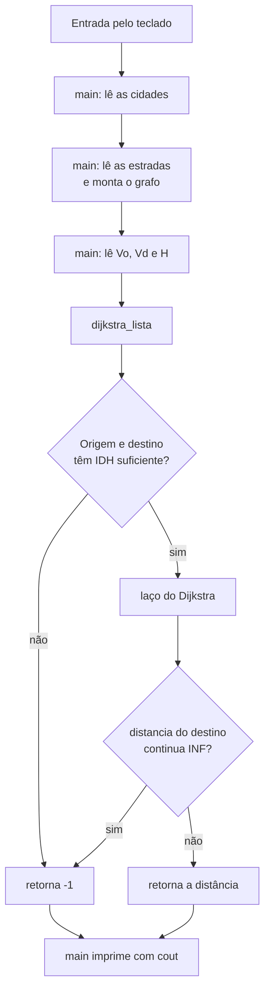
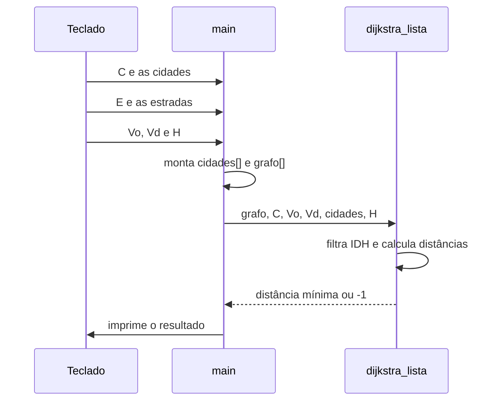
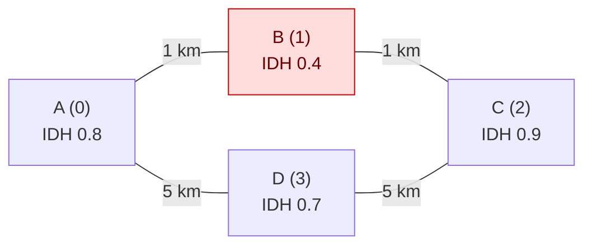
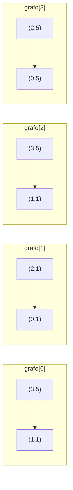
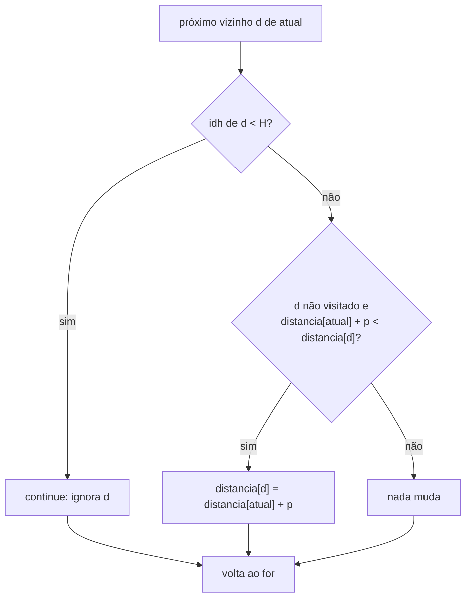
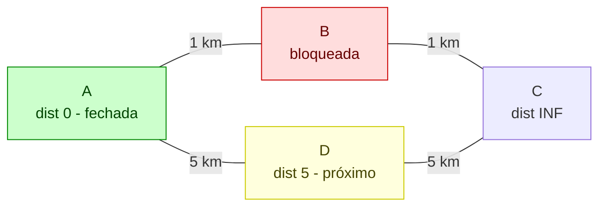
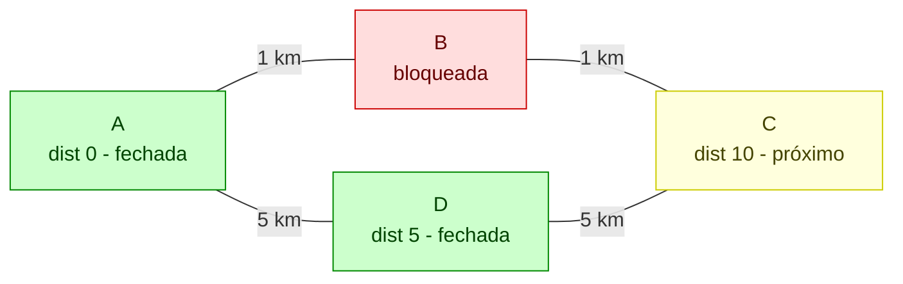
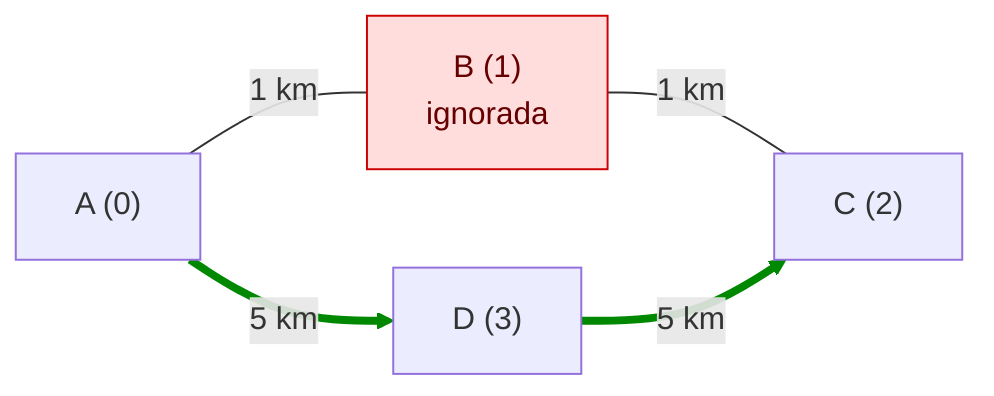

# Menor rota entre cidades com filtro de IDH (Dijkstra em C++)

> [!abstract] Resumo
> Dado um mapa de cidades (cada uma com nome e IDH) ligadas por estradas de mão dupla, calcular a **menor distância** entre uma origem e um destino usando **apenas cidades com IDH maior ou igual a H**.
> Solução: **Dijkstra** na versão clássica O(V²), com lista de adjacência, **sem `vector`**, e com um `continue` que funciona como filtro de IDH.

---

## 1. Por que Dijkstra

| Algoritmo | Serve para | Resolve este problema? |
|---|---|---|
| BFS | menor caminho em **número de arestas** | Não: ignora os quilômetros |
| DFS | explorar, conectividade, ciclos | Não: o primeiro caminho achado pode ser péssimo |
| **Dijkstra** | menor caminho com **pesos positivos** | **Sim** |
| Kruskal / Prim | árvore geradora mínima | Não: conectam *todas* as cidades, não otimizam um par origem-destino |

> [!tip] Onde BFS e DFS ainda aparecem
> O Dijkstra funciona como uma BFS que, em vez de expandir "o próximo da fila", expande **o vértice de menor distância acumulada**.

---

## 2. Visão geral do programa



Quem faz o quê:



---

## 3. Exemplo usado nas simulações

### Entrada

```
4
A 0.8
B 0.4
C 0.9
D 0.7
4
0 1 1
1 2 1
0 3 5
3 2 5
0 2 0.6
```

| Linha | Significado |
|---|---|
| `4` | C = 4 cidades |
| `A 0.8` ... `D 0.7` | cidades com códigos 0, 1, 2, 3 (ordem de entrada) |
| `4` | E = 4 estradas |
| `0 1 1` ... `3 2 5` | `Co Cd D`: origem, destino e distância |
| `0 2 0.6` | `Vo = 0`, `Vd = 2`, `H = 0.6` |

### O grafo

Cidade em vermelho = IDH abaixo de H (será ignorada).



> [!question] Resposta esperada
> Pelo meio (A → B → C) seriam 2 km, mas B tem IDH 0,4 e não pode ser usada.
> Sobra A → D → C = 5 + 5 = **10**.

---

## 4. Código completo

```cpp
#include <iostream>
#include <list>
#include <string>
using namespace std;

const int MAX = 1000;            // limite máximo de cidades
const int INF = 1000000000;      // "infinito"

struct Cidade {
  string nome;
  double idh;
};

struct Aresta {
  int origem, destino, peso;
};

int dijkstra_lista(list<Aresta> grafo[], int vertices, int origem, int destino,
                   Cidade cidades[], double H) {

  if (cidades[origem].idh < H || cidades[destino].idh < H)
    return -1;

  bool visitado[MAX];
  int distancia[MAX];
  int atual;
  list<Aresta>::iterator it;

  for (int i = 0; i < vertices; i++) {
    visitado[i] = false;
    distancia[i] = INF;
  }
  distancia[origem] = 0;
  atual = origem;

  while (!visitado[atual]) {
    visitado[atual] = true;

    for (it = grafo[atual].begin(); it != grafo[atual].end(); it++) {
      int d = it->destino, p = it->peso;

      if (cidades[d].idh < H) continue;

      if (!visitado[d] && distancia[atual] + p < distancia[d])
        distancia[d] = distancia[atual] + p;
    }

    int menor_distancia = INF;
    for (int i = 0; i < vertices; i++) {
      if (!visitado[i] && distancia[i] < menor_distancia) {
        menor_distancia = distancia[i];
        atual = i;
      }
    }
  }

  return (distancia[destino] == INF) ? -1 : distancia[destino];
}

int main() {
  int C, E;

  cin >> C;
  Cidade cidades[MAX];
  for (int i = 0; i < C; i++)
    cin >> cidades[i].nome >> cidades[i].idh;

  cin >> E;
  list<Aresta> grafo[MAX];
  for (int i = 0; i < E; i++) {
    int co, cd, dist;
    cin >> co >> cd >> dist;
    grafo[co].push_front({co, cd, dist});
    grafo[cd].push_front({cd, co, dist});
  }

  int Vo, Vd;
  double H;
  cin >> Vo >> Vd >> H;

  cout << dijkstra_lista(grafo, C, Vo, Vd, cidades, H) << endl;
  return 0;
}
```

---

## 5. Explicação bloco a bloco

### 5.1 Includes e constantes

```cpp
#include <iostream>
#include <list>
#include <string>
using namespace std;

const int MAX = 1000;
const int INF = 1000000000;
```

| Item | Função |
|---|---|
| `<iostream>` | `cin` e `cout` |
| `<list>` | lista encadeada usada na lista de adjacência |
| `<string>` | nome das cidades |
| `MAX` | tamanho **fixo** dos arrays. Em C++ padrão, o tamanho de um array comum precisa ser constante, por isso `bool v[n]` com `n` variável fica em vermelho |
| `INF` | "distância infinita" = ainda não alcançado. 10⁹ é maior que qualquer soma possível e ainda cabe em `int` |

> [!warning] Ajuste o MAX
> Se o enunciado permitir mais de 1000 cidades, aumente `MAX`. Se `C > MAX`, o programa acessa posições inexistentes.

### 5.2 Os structs

```cpp
struct Cidade {
  string nome;
  double idh;
};

struct Aresta {
  int origem, destino, peso;
};
```

- `Cidade` agrupa os dados de cada vértice. O **código** da cidade é o **índice** no array `cidades[]`.
- `Aresta` descreve uma estrada: de onde sai, para onde vai e quantos km tem.

### 5.3 O `main`: leitura das cidades

```cpp
cin >> C;
Cidade cidades[MAX];
for (int i = 0; i < C; i++)
  cin >> cidades[i].nome >> cidades[i].idh;
```

**Simulação** com o exemplo:

| i | Lê | Resultado |
|---|---|---|
| 0 | `A 0.8` | `cidades[0] = {"A", 0.8}` |
| 1 | `B 0.4` | `cidades[1] = {"B", 0.4}` |
| 2 | `C 0.9` | `cidades[2] = {"C", 0.9}` |
| 3 | `D 0.7` | `cidades[3] = {"D", 0.7}` |

Memória depois do bloco:

```
cidades:  [0] A 0.8 | [1] B 0.4 | [2] C 0.9 | [3] D 0.7
```

### 5.4 O `main`: leitura das estradas

```cpp
cin >> E;
list<Aresta> grafo[MAX];
for (int i = 0; i < E; i++) {
  int co, cd, dist;
  cin >> co >> cd >> dist;
  grafo[co].push_front({co, cd, dist});
  grafo[cd].push_front({cd, co, dist});
}
```

`grafo[u]` é a lista de estradas que **saem** de `u` (lista de adjacência).

> [!important] Mão dupla
> Cada estrada entra **duas vezes**: uma na lista da origem e outra na lista do destino. Sem isso, só seria possível andar em um sentido.

**Simulação** (`push_front` coloca a estrada mais nova na frente):

| i | Lê | `grafo[0]` | `grafo[1]` | `grafo[2]` | `grafo[3]` |
|---|---|---|---|---|---|
| 0 | `0 1 1` | (1,1) | (0,1) | | |
| 1 | `1 2 1` | (1,1) | (2,1) (0,1) | (1,1) | |
| 2 | `0 3 5` | (3,5) (1,1) | (2,1) (0,1) | (1,1) | (0,5) |
| 3 | `3 2 5` | (3,5) (1,1) | (2,1) (0,1) | (3,5) (1,1) | (2,5) (0,5) |

Cada par `(d, p)` significa: "dá para ir até a cidade `d` gastando `p` km".



### 5.5 O `main`: leitura da consulta e chamada

```cpp
cin >> Vo >> Vd >> H;
cout << dijkstra_lista(grafo, C, Vo, Vd, cidades, H) << endl;
```

No exemplo: `Vo = 0` (A), `Vd = 2` (C), `H = 0.6`. O `main` entrega tudo à função e imprime o inteiro que ela devolver.

### 5.6 Assinatura da função

```cpp
int dijkstra_lista(list<Aresta> grafo[], int vertices, int origem, int destino,
                   Cidade cidades[], double H)
```

| Parâmetro | Papel |
|---|---|
| `grafo[]` | lista de adjacência (as estradas) |
| `vertices` | quantas cidades existem de fato (`C`). Usado só como limite de laço |
| `origem`, `destino` | `Vo` e `Vd` |
| `cidades[]` | consultado para ler o IDH |
| `H` | IDH mínimo |

> [!note] Arrays passados por ponteiro
> Arrays em C++ são passados sem cópia: a função enxerga o mesmo array do `main`.

### 5.7 Checagem inicial

```cpp
if (cidades[origem].idh < H || cidades[destino].idh < H)
  return -1;
```

Se a origem ou o destino já não atingem o IDH mínimo, a viagem é impossível. Retorna `-1` e nem roda o algoritmo.

| Cenário | Resultado |
|---|---|
| `H = 0.6`, origem A (0.8), destino C (0.9) | passa, segue |
| `H = 0.95` | C (0.9) é menor que 0,95: retorna `-1` |

### 5.8 Inicialização

```cpp
bool visitado[MAX];
int distancia[MAX];
int atual;
list<Aresta>::iterator it;

for (int i = 0; i < vertices; i++) {
  visitado[i] = false;
  distancia[i] = INF;
}
distancia[origem] = 0;
atual = origem;
```

| Variável | Significado |
|---|---|
| `visitado[i]` | `true` = a menor distância até `i` já está **definitiva** (vértice "fechado") |
| `distancia[i]` | melhor distância conhecida da origem até `i` |
| `atual` | vértice sendo processado |
| `it` | iterador para percorrer a lista de um vértice |

Estado inicial do exemplo:

| Cidade | 0 (A) | 1 (B) | 2 (C) | 3 (D) |
|---|---|---|---|---|
| `distancia` | **0** | INF | INF | INF |
| `visitado` | F | F | F | F |

`atual = 0`.

### 5.9 Laço principal e marcação

```cpp
while (!visitado[atual]) {
  visitado[atual] = true;
```

- O laço repete enquanto o `atual` ainda não foi fechado.
- Ao entrar, o vértice é **fechado**: pela propriedade do Dijkstra (pesos não negativos), ninguém consegue melhorar essa distância depois.
- **Condição de parada:** quando não sobra nenhum vértice alcançável, `atual` não muda, já está visitado, e o `while` termina.

### 5.10 Relaxamento com filtro de IDH

```cpp
for (it = grafo[atual].begin(); it != grafo[atual].end(); it++) {
  int d = it->destino, p = it->peso;

  if (cidades[d].idh < H) continue;

  if (!visitado[d] && distancia[atual] + p < distancia[d])
    distancia[d] = distancia[atual] + p;
}
```

Percorre cada vizinho `d` de `atual`:

1. **Filtro:** se o IDH de `d` é menor que `H`, o `continue` **pula** esse vizinho. Ele nunca recebe distância e nunca será escolhido.
2. **Relaxamento:** se `d` ainda não foi fechado **e** passar por `atual` é mais barato que o melhor caminho conhecido até `d`, atualiza `distancia[d]`.



> [!info] `continue` x `break` x `return`
> | Comando | Efeito |
> |---|---|
> | `continue` | pula para a **próxima iteração** do laço |
> | `break` | **sai** do laço inteiro |
> | `return` | **sai da função** |
>
> Usar `break` no filtro seria um erro: pararia de olhar os vizinhos restantes e poderia perder uma rota válida.

### 5.11 Escolha do próximo vértice

```cpp
int menor_distancia = INF;
for (int i = 0; i < vertices; i++) {
  if (!visitado[i] && distancia[i] < menor_distancia) {
    menor_distancia = distancia[i];
    atual = i;
  }
}
```

Varre todos os vértices e escolhe o **não visitado de menor distância**. É essa varredura linear que dá ao algoritmo complexidade **O(V²)**.

- Cidades barradas pelo IDH ficam com `INF`: nunca satisfazem `distancia[i] < INF`, então nunca são escolhidas.
- Se nenhum vértice satisfaz a condição, `atual` **não muda**. Como já está visitado, o `while` termina.

### 5.12 Retorno

```cpp
return (distancia[destino] == INF) ? -1 : distancia[destino];
```

| Situação | Retorno |
|---|---|
| destino recebeu distância finita | a distância mínima |
| destino continuou em `INF` | `-1` (sem rota válida) |

> [!warning] Confirme com o professor
> O enunciado não diz o que imprimir quando não há rota. `-1` é uma convenção comum.

---

## 6. Simulação completa do Dijkstra

Entrada do exemplo: `Vo = 0`, `Vd = 2`, `H = 0.6`.

Listas de adjacência (já montadas):

```
grafo[0]: (3,5) (1,1)
grafo[1]: (2,1) (0,1)
grafo[2]: (3,5) (1,1)
grafo[3]: (2,5) (0,5)
```

### Iteração 1: `atual = 0` (A)

1. `visitado[0] = true`.
2. Vizinhos de A:
   - `(3,5)`: D tem IDH 0,7, passa. `0 + 5 < INF`, então `distancia[3] = 5`.
   - `(1,1)`: B tem IDH 0,4 < 0,6, **`continue`**. Fica em `INF`.
3. Escolha: entre os não visitados, o menor é D (5). **`atual = 3`**.



| | A (0) | B (1) | C (2) | D (3) |
|---|---|---|---|---|
| `distancia` | 0 | INF | INF | **5** |
| `visitado` | **T** | F | F | F |

### Iteração 2: `atual = 3` (D)

1. `visitado[3] = true`.
2. Vizinhos de D:
   - `(2,5)`: C tem IDH 0,9, passa. `5 + 5 = 10 < INF`, então `distancia[2] = 10`.
   - `(0,5)`: A passa no filtro, mas `visitado[0]` é `true`: ignorada.
3. Escolha: o único não visitado com distância finita é C (10). **`atual = 2`**.



| | A (0) | B (1) | C (2) | D (3) |
|---|---|---|---|---|
| `distancia` | 0 | INF | **10** | 5 |
| `visitado` | T | F | F | **T** |

### Iteração 3: `atual = 2` (C)

1. `visitado[2] = true`.
2. Vizinhos de C:
   - `(3,5)`: D já visitada, ignorada.
   - `(1,1)`: B tem IDH 0,4, **`continue`**.
3. Escolha: restou só B, com `INF`. `INF < INF` é falso, então ninguém é escolhido e **`atual` continua 2**.

| | A (0) | B (1) | C (2) | D (3) |
|---|---|---|---|---|
| `distancia` | 0 | INF | 10 | 5 |
| `visitado` | T | F | **T** | T |

### Fim

`while (!visitado[2])` agora é falso: o laço termina.
`distancia[2] = 10`, diferente de `INF`: **retorna 10**.



**Rota final:** A → D → C = **10**.

---

## 7. Outras simulações

### Mesmo mapa com `H = 0.3` (todas as cidades passam)

| Iteração | `atual` | O que acontece | `distancia` [A, B, C, D] |
|---|---|---|---|
| 1 | A (0) | D recebe 5, B recebe 1. Próximo: B (1) | [0, 1, INF, 5] |
| 2 | B (1) | C recebe 1 + 1 = 2. Próximo: C (2) | [0, 1, 2, 5] |
| 3 | C (2) | D: 2 + 5 = 7, não melhora 5. Próximo: D (5) | [0, 1, 2, 5] |
| 4 | D (3) | tudo já visitado, `atual` não muda | [0, 1, 2, 5] |

Retorno: `distancia[2] = 2`.

### Mesmo mapa com `H = 0.95`

A checagem inicial barra: `cidades[2].idh` (0,9) é menor que 0,95. Retorno: **-1**, sem rodar o laço.

### Resumo dos três testes

| H | Resposta | Motivo |
|---|---|---|
| 0.3 | 2 | B passa, rota curta A → B → C |
| 0.6 | 10 | B barrada, rota A → D → C |
| 0.95 | -1 | destino C não atinge o IDH |

---

## 8. Complexidade

| Parte | Custo |
|---|---|
| Inicialização | O(V) |
| `while`: no máximo V iterações, cada uma com varredura de V | O(V²) |
| Percorrer todas as arestas (somando todas as iterações) | O(E) |
| **Total** | **O(V² + E)** |

> [!tip] Como melhorar
> Trocar a varredura linear por uma `priority_queue` leva o algoritmo a O((V + E) log V). Para grafos grandes e esparsos, vale a pena.

---

## 9. Erros comuns

- [ ] **Esquecer a aresta de volta:** as estradas são de mão dupla, são duas inserções.
- [ ] **`vertices` em vermelho:** array com tamanho variável não é C++ padrão. Use constante (`MAX`) ou alocação dinâmica.
- [ ] **Laço até `MAX` em vez de `vertices`:** o Dijkstra poderia escolher posições que não são cidades.
- [ ] **`>=` ou `>` no IDH:** o enunciado é ambíguo. Com `< H` no filtro, IDH igual a H é aceito. Para exigir estritamente maior, troque por `<= H`.
- [ ] **Nomes com espaço:** `cin >>` lê só até o espaço ("Santa Rita" quebraria). Use `getline` se os testes tiverem isso.
- [ ] **Esquecer de tratar origem ou destino abaixo do IDH:** a checagem inicial resolve.
- [ ] **Destino inalcançável:** retornar `-1` evita imprimir `1000000000`.

---

## 10. Exercícios para fixar

1. Faça a simulação em papel para `Vo = 1`, `Vd = 3` e `H = 0.3`.
2. Altere o código para também imprimir o **caminho** percorrido. Dica: crie `int pai[MAX]` atualizado junto com `distancia[d]` e reconstrua a rota de trás para frente a partir do destino.
3. Mude o filtro para considerar **apenas IDH estritamente maior** que H e refaça o teste com `H = 0.7` (D tem exatamente 0,7).
4. Reescreva a escolha do próximo vértice usando `priority_queue` e compare com esta versão.
